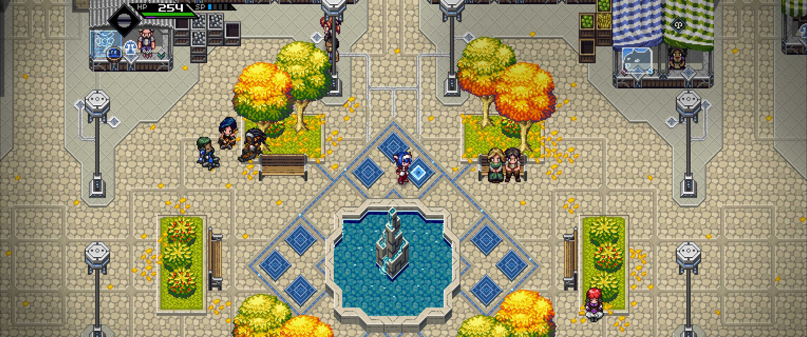

# CrossCode-Ultrawide

Makes CrossCode fill ultrawide screens (21:9 and wider) instead of showing black bars.

Most of the HUD and menus stay in their original 16:9 layout in the middle of the screen.

Made for CrossCode 1.4.2-4 (Steam).

##INSTALL 

WINDOWS:

1. Put install-ultrawide.bat in the CrossCode folder, next to CrossCode.exe. (Steam: right-click CrossCode > Manage > Browse local files.)
   
2. Double-click install-ultrawide.bat.

LINUX:

1. Put install-ultrawide.sh in the CrossCode folder (the one containing "assets" folder).
   
2. In a terminal in that folder run:   sh install-ultrawide.sh

Then, in the game, keep Options > Video > Display Type on "Fit" and play in fullscreen.

##UNINSTALL

Windows: double-click uninstall-ultrawide.bat in the CrossCode folder.

Linux:   sh uninstall-ultrawide.sh

Both are created by the installer; they reverse the changes and delete themselves.

Steam's "Verify integrity of game files" also removes the patch.

##WHAT IT CHANGES

- adds   assets/ultrawide.js

- edits  assets/node-webkit.html   (one line that loads ultrawide.js)

- edits  assets/js/game.compiled.js (three small hooks in the GUI layout code)

##NOTES

- Distant backgrounds that were drawn only for 16:9 are centered, and their edges are mirrored to fill the extra width.

- 32:9 and up weren't tested.

- The Linux installer wasn't tested on an actual Linux machine - Lmk if it works or not!

- Claude was used extensively in the creation of this mod.